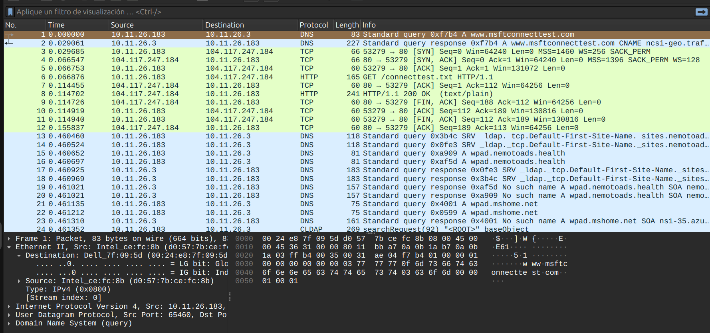
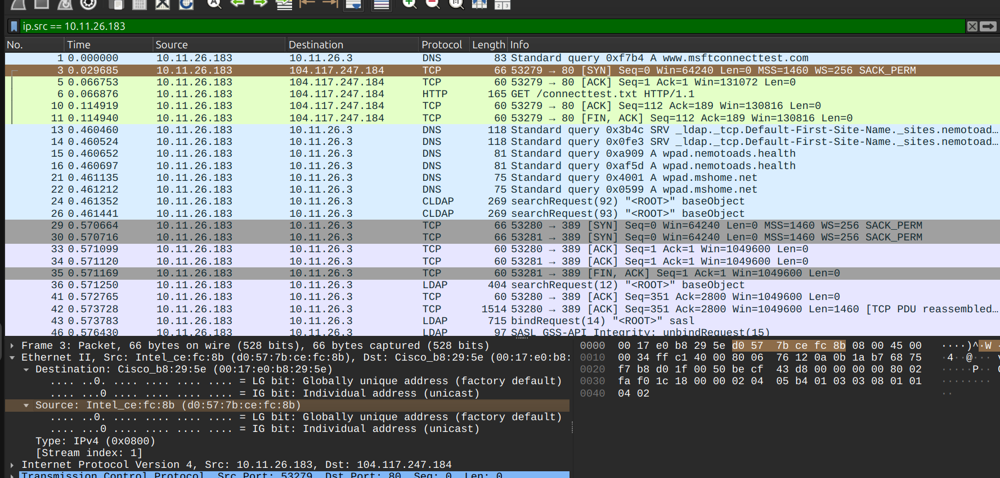
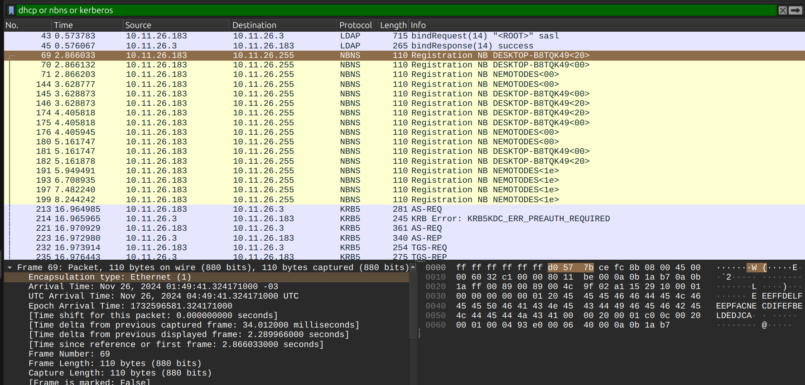
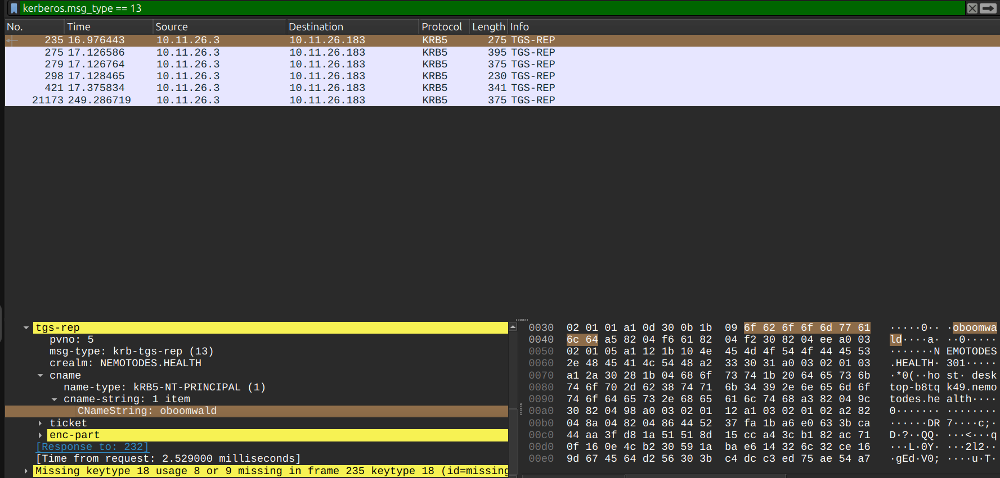
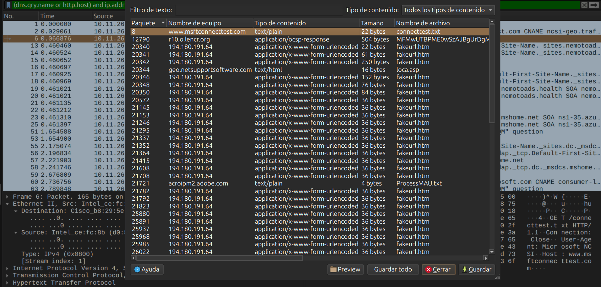
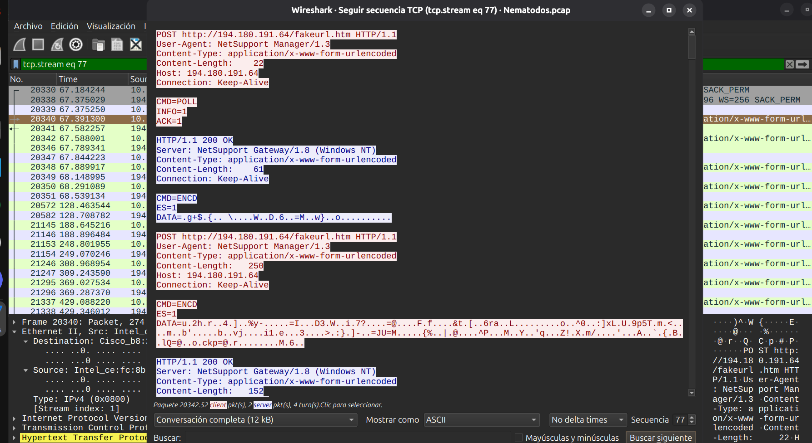

# Informe de análisis forense de red: Nematodos

## Información general

| Campo | Valor |
|---|---|
| Plataforma | The Hackers Labs |
| Categoría | Forense |
| Dificultad | Avanzado |
| Archivo analizado | `Nematodos.pcap` |
| Herramienta documentada | Wireshark |

Este documento registra la investigación realizada sobre la captura de tráfico `Nematodos.pcap`. Las conclusiones y los indicadores que siguen se limitan a lo legible en las capturas incluidas en `img/`; no se atribuyen valores que no estén visibles en esa evidencia.

## Resumen ejecutivo del incidente

La captura identifica como equipo analizado al host `10.11.26.183`, con nombre NetBIOS `DESKTOP-B8TQK49`, en el entorno `NEMOTODES.HEALTH`. En la fase inicial se observan una comprobación de conectividad HTTP hacia `www.msftconnecttest.com` y consultas de descubrimiento de servicios y nombres de Windows. Estos paquetes, por sí solos, no demuestran el vector de infección.

La evidencia de mayor relevancia aparece en el flujo TCP 77: el host víctima intercambia solicitudes HTTP POST con `194.180.191.64` en la ruta `/fakeurl.htm`. La conversación contiene `User-Agent: NetSupport Manager/1.3` y mensajes de aplicación `CMD=POLL`, `CMD=ENCD` y datos codificados, patrón compatible con un canal de control remoto NetSupport. Wireshark decodifica este HTTP sobre TCP/443 en el paquete mostrado.

Las capturas no identifican de manera concluyente el archivo o mecanismo que inició la infección. La ventana de objetos HTTP muestra nombres como `fakeurl.htm`, `loca.asp` y `ProcessMAU.txt`, pero no basta para afirmar que alguno sea el ejecutable inicial o un payload malicioso. Tampoco se observa en las imágenes una respuesta de descarga con un binario inequívocamente identificado.

## Indicadores de compromiso y datos del host

| Tipo | Valor observado | Contexto / confianza de interpretación |
|---|---|---|
| IP de la víctima | `10.11.26.183` | Origen de los paquetes y dirección usada en los filtros |
| Dirección MAC de la víctima | `d0:57:7b:ce:fc:8b` | Dirección de origen Ethernet visible en los paquetes del host |
| MAC de destino del paquete 3 | `00:17:e0:b8:29:5e` | Dirección de destino Ethernet visible en el tráfico hacia `104.117.247.184` |
| MAC de destino del paquete 1 | `00:24:e8:7f:09:5d` | Dirección de destino Ethernet visible en la consulta DNS inicial |
| Nombre del equipo | `DESKTOP-B8TQK49` | Registrado mediante NBNS |
| Dominio / entorno | `NEMOTODES.HEALTH` | Realm Kerberos visible; NBNS también anuncia `NEMOTODES` |
| Usuario | `oboomwald` | `cNameString` visible en la respuesta Kerberos |
| DNS / servicio de directorio local | `10.11.26.3` | Destino de consultas DNS, LDAP y Kerberos de la víctima |
| IP de C2 observada | `194.180.191.64` | Destino del POST HTTP del paquete 20340 |
| Ruta HTTP observada | `http://194.180.191.64/fakeurl.htm` | URI mostrada en el paquete 20340 |
| Transporte del flujo | TCP/443 | Puerto de destino visible en el detalle del paquete; el contenido está decodificado como HTTP |
| Identificador de flujo | `tcp.stream eq 77` | Filtro con el que se inspecciona la conversación |
| User-Agent | `NetSupport Manager/1.3` | Cabecera HTTP visible en el seguimiento de flujo |
| Mensajes de aplicación | `CMD=POLL`, `CMD=ENCD`, `INFO=1`, `ACK=1`, `ES=1` | Campos visibles en los cuerpos de las solicitudes/respuestas |
| Nombres HTTP visibles | `connecttest.txt`, `fakeurl.htm`, `loca.asp`, `ProcessMAU.txt` | Objetos mostrados en la lista de objetos HTTP; su presencia no demuestra por sí sola que sean payloads |
| Dominio consultado | `wpad.nemotoads.health` | Consulta DNS visible; la respuesta se muestra como `No such name` |
| Host HTTP visible | `geo.netsupportsoftware.com` | Aparece en la lista de objetos HTTP; no se atribuye como C2 confirmado |
| Direcciones de descubrimiento | `10.11.26.255`, `239.255.255.250` | Destinos de los anuncios NBNS y búsquedas SSDP visibles |
| Paquetes relevantes | `1`, `3`, `6`, `69`, `20340`, `20342` | Números visibles en las capturas de apertura, identificación, contexto y C2 |

> **Alcance de los IoC:** la IP y URI de `194.180.191.64` están directamente asociadas al intercambio de control observado. Los nombres de objetos y dominios adicionales se consignan como valores visibles, no como indicadores maliciosos confirmados.

## Investigación forense paso a paso

### 1. Apertura y revisión inicial de la captura

Se abrió `Nematodos.pcap` en Wireshark y se revisaron los primeros paquetes sin un filtro de visualización visible. El paquete 1 muestra una consulta DNS desde `10.11.26.183` hacia `10.11.26.3` para `www.msftconnecttest.com`. A continuación, el paquete 6 contiene una solicitud `GET /connecttest.txt` hacia `104.117.247.184` por HTTP. Esta actividad constituye contexto de red inicial; no se interpreta como vector de infección.

### 2. Identificación del tráfico HTTP/DNS del host

Se aplicó el filtro `http.request or dns` para separar las solicitudes HTTP y consultas DNS. En el listado se confirma `10.11.26.183` como origen, el servidor DNS `10.11.26.3` y el paquete 6 con `GET /connecttest.txt HTTP/1.1`. Esta vista ayuda a fijar la IP víctima y a distinguir el tráfico inicial de las comunicaciones posteriores.

### 3. Identificación de la dirección MAC de la víctima

Con el filtro `ip.src == 10.11.26.183` se aislaron los paquetes originados por el host. El detalle Ethernet del paquete 3 muestra como MAC de origen `d0:57:7b:ce:fc:8b`; para ese paquete, la MAC de destino es `00:17:e0:b8:29:5e`.

### 4. Extracción del nombre de usuario mediante Kerberos

Se utilizó `kerberos.msg_type == 13` para filtrar respuestas de servicio Kerberos. En el paquete 235, el detalle de `TGS-REP` muestra el realm `NEMOTODES.HEALTH` y el `cNameString` `oboomwald`. Este valor se registra como nombre de usuario observado en la captura.

### 5. Reconocimiento del nombre del equipo y del entorno Windows

El filtro `dhcp or nbns or kerberos` se usó para inspeccionar protocolos de configuración y resolución de nombres, junto con Kerberos. Las solicitudes NBNS incluyen registros de `DESKTOP-B8TQK49` y `NEMOTODES`; el paquete 69 muestra `DESKTOP-B8TQK49<20>`. La evidencia permite documentar el nombre NetBIOS del equipo y el nombre `NEMOTODES` anunciado en la red.

### 6. Revisión de consultas DNS y nombres consultados

Se aplicó `(dns.qry.name or http.host) and ip.addr == 10.11.26.183` para revisar nombres consultados o alojados en HTTP vinculados a la víctima. Se observa la consulta `wpad.nemotoads.health`; la respuesta correspondiente aparece como `No such name`. También se muestran consultas de WPAD hacia `wpad.mshome.net` con respuestas negativas. Por ello, estos nombres se documentan como consultas fallidas, no como resolución exitosa ni como C2 confirmado.

### 7. Inspección de objetos HTTP y selección del paquete relevante

La lista de objetos HTTP muestra, entre otros, `connecttest.txt`, varias entradas `fakeurl.htm`, `loca.asp` y `ProcessMAU.txt`; también aparece `geo.netsupportsoftware.com` como nombre de equipo para un objeto. La captura no demuestra que esos objetos sean todos maliciosos ni identifica por sí sola un binario descargado. Para centrar el análisis se aplicó `frame.number == 20340`: el paquete 20340 es un POST de `10.11.26.183` a `194.180.191.64` con la URI `http://194.180.191.64/fakeurl.htm`.

### 8. Correlación del tráfico hacia el servidor remoto

Se filtró `tcp.stream eq 77` para seguir la conexión asociada al paquete 20340. El listado de paquetes muestra tráfico repetido entre la víctima y `194.180.191.64`, incluyendo solicitudes POST a `/fakeurl.htm`. En el detalle del paquete 20340, el puerto destino TCP es `443`, aunque la petición y su contenido se decodifican como HTTP.

### 9. Análisis del contenido de la conversación C2

Se abrió el seguimiento TCP del flujo 77 y se visualizó la conversación completa en ASCII. Las solicitudes muestran `User-Agent: NetSupport Manager/1.3`, `Content-Type: application/x-www-form-urlencoded` y el cuerpo `CMD=POLL`, `INFO=1`, `ACK=1`. Las respuestas incluyen `CMD=ENCD`, `ES=1` y campos `DATA` con contenido codificado; aparecen nuevas solicitudes `CMD=ENCD`. El intercambio respalda la identificación de una comunicación de control compatible con NetSupport, sin permitir reconstruir el contenido codificado solo a partir de esta captura de pantalla.

## Conclusiones

1. La evidencia de red identifica al equipo víctima `10.11.26.183` (`DESKTOP-B8TQK49`), la MAC `d0:57:7b:ce:fc:8b`, el entorno `NEMOTODES.HEALTH` y el usuario Kerberos `oboomwald`.
2. Se observa una comunicación de control remoto con `194.180.191.64`, concretamente `http://194.180.191.64/fakeurl.htm`, sobre TCP/443 con contenido HTTP visible.
3. Las cabeceras y los comandos de aplicación observados (`NetSupport Manager/1.3`, `CMD=POLL` y `CMD=ENCD`) son compatibles con un canal de administración remota NetSupport.
4. Las capturas no permiten establecer con certeza el vector inicial, el momento de ejecución del implante ni un nombre de archivo ejecutable descargado. Los nombres de objetos HTTP se mantienen como observaciones, no como atribuciones.
5. Las búsquedas DNS de WPAD mostradas reciben respuestas negativas; no prueban resolución ni conexión con `wpad.nemotoads.health`.

## Recomendaciones de mitigación y respuesta

- Aislar el host afectado y preservar la captura original y la evidencia del endpoint antes de remediar; registrar hashes y cadena de custodia en el expediente de respuesta.
- Bloquear o restringir temporalmente el tráfico hacia `194.180.191.64` y revisar registros de DNS, proxy, firewall y EDR para buscar conexiones relacionadas, tanto desde este equipo como desde otros activos.
- Realizar análisis del endpoint para localizar instalaciones o procesos de NetSupport no autorizados, persistencia, tareas programadas, servicios y archivos asociados; validar los hallazgos con telemetría local antes de eliminar artefactos.
- Revisar los objetos HTTP y el contenido de la captura en el entorno forense para recuperar archivos cuando sea posible; calcular hashes y analizarlos de forma aislada antes de clasificarlos.
- Restablecer credenciales potencialmente expuestas, empezando por la cuenta `oboomwald`, y comprobar autenticaciones Kerberos y actividad lateral anómala en el dominio.
- Correlacionar la línea temporal del PCAP con registros de Windows, DNS y controles perimetrales para identificar el vector de entrada y determinar el alcance real del incidente.
- Mantener inspección y alertas para conexiones HTTP no cifradas o decodificables en puertos no habituales, así como para tráfico de administración remota no aprobado.
