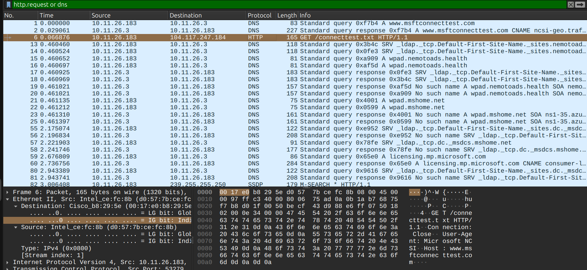
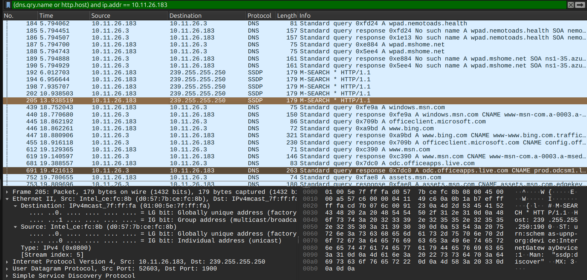
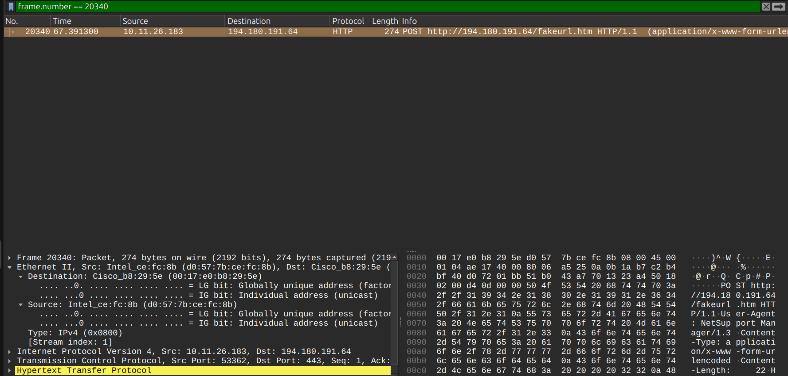
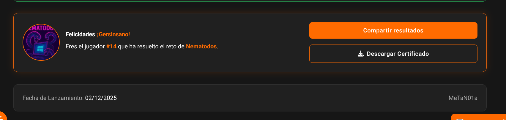

# Resolución del laboratorio forense Nematodos

## Introducción

En este laboratorio de **The Hackers Labs**, categoría **Forense** y dificultad **Avanzado**, analicé el archivo `Nematodos.pcap` con Wireshark en Ubuntu. El objetivo fue revisar el tráfico, identificar el equipo víctima y seguir la comunicación sospechosa hasta el servidor de control.

## Investigación paso a paso

### 1. Abrir la captura y revisar los primeros paquetes

Abrí `Nematodos.pcap` en Wireshark y comencé revisando los primeros paquetes. El paquete 1 muestra una consulta DNS desde `10.11.26.183` al servidor DNS `10.11.26.3` por `www.msftconnecttest.com`. Después, el paquete 6 muestra una petición `GET /connecttest.txt` hacia `104.117.247.184`. Estos paquetes sirven como contexto inicial; por sí solos no indican cómo se produjo la infección.

### 2. Localizar la IP de la víctima

Apliqué el filtro `http.request or dns` para revisar las consultas DNS y las peticiones HTTP. En los paquetes filtrados se ve que `10.11.26.183` inicia las consultas y las solicitudes relevantes; por eso la tomé como IP de la víctima. El servidor DNS observado es `10.11.26.3`.

### 3. Obtener la dirección MAC

Usé el filtro `ip.src == 10.11.26.183` y revisé el detalle Ethernet del paquete 3. La dirección MAC de origen del equipo es `d0:57:7b:ce:fc:8b`. En ese mismo paquete, la MAC de destino visible es `00:17:e0:b8:29:5e`.

### 4. Identificar el usuario

Con el filtro `kerberos.msg_type == 13` revisé las respuestas `TGS-REP`. En el paquete 235, el campo `cNameString` muestra el usuario `oboomwald` y el realm `NEMOTODES.HEALTH`.

### 5. Identificar el hostname

Apliqué `dhcp or nbns or kerberos` para revisar información de configuración y resolución de nombres de Windows. Los registros NBNS muestran `DESKTOP-8BTQK49` y `NEMOTODES`; el paquete 69 incluye el registro `DESKTOP-8BTQK49<20>`. Así identifiqué el hostname como `DESKTOP-8BTQK49`.

### 6. Revisar los dominios consultados

Usé el filtro `(dns.qry.name or http.host) and ip.addr == 10.11.26.183` para revisar nombres DNS y hosts HTTP asociados al equipo. Entre las consultas aparece `wpad.nemotoads.health`, pero la respuesta indica `No such name`. También aparecen consultas a `wpad.mshome.net` con respuestas negativas. Por lo tanto, estas consultas no confirman una conexión con esos dominios.

### 7. Revisar objetos HTTP y encontrar el paquete de interés

Abrí la lista de objetos HTTP. Allí se ven nombres como `connecttest.txt`, `fakeurl.htm`, `loca.asp` y `ProcessMAU.txt`. La captura no demuestra que esos nombres correspondan a un ejecutable o a un archivo que haya iniciado la infección.

Luego apliqué `frame.number == 20340`. El paquete 20340 muestra una petición POST desde `10.11.26.183` hacia `194.180.191.64`, con la ruta `/fakeurl.htm`. Esta comunicación es la evidencia más clara del servidor remoto de control en las capturas.

### 8. Seguir la conexión hacia el servidor C2

Para revisar la conversación completa utilicé el filtro `tcp.stream eq 77`. En ese flujo se repiten las comunicaciones entre `10.11.26.183` y `194.180.191.64`, con solicitudes POST a `/fakeurl.htm`. El paquete destacado usa el puerto TCP de destino `443`; Wireshark muestra el contenido de la solicitud como HTTP.

### 9. Revisar el contenido del flujo

Abrí **Seguir secuencia TCP** para el flujo 77 y seleccioné la vista ASCII. Las solicitudes muestran el `User-Agent: NetSupport Manager/1.3` y los campos `CMD=POLL`, `INFO=1` y `ACK=1`. En las respuestas se ven `CMD=ENCD`, `ES=1` y datos en el campo `DATA`. Estos elementos son compatibles con comunicación de control de NetSupport entre la víctima y `194.180.191.64`.

### Sobre el vector de entrada

En las capturas disponibles no aparece evidencia suficiente para determinar cómo se infectó inicialmente el equipo. La lista de objetos HTTP incluye nombres de archivos, pero no identifica de forma concluyente un payload de entrada ni demuestra que alguno de esos objetos iniciara la infección. Lo que sí se puede establecer con estas capturas es que el host ya se comunica con `194.180.191.64` mediante solicitudes compatibles con un canal de control NetSupport.

## Conclusión

El análisis permitió identificar a la víctima como `10.11.26.183` (`DESKTOP-8BTQK49`), con MAC `d0:57:7b:ce:fc:8b` y usuario `oboomwald`. La comunicación más relevante es el flujo TCP 77 hacia `194.180.191.64`, usando la ruta `/fakeurl.htm` y mostrando comandos compatibles con NetSupport. Con la evidencia de las capturas no es posible confirmar el vector inicial de infección, por lo que haría falta correlacionar el PCAP con registros y archivos del equipo afectado.

## Máquina resuelta

Captura de confirmación de la plataforma tras completar el reto Nematodos.

